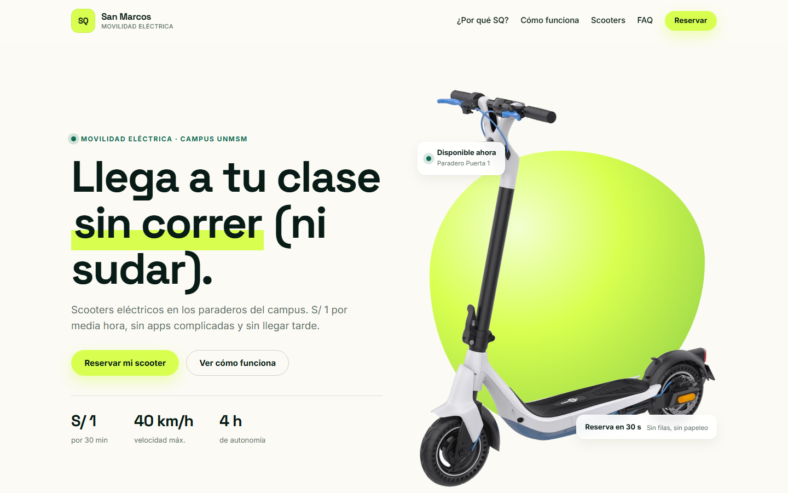
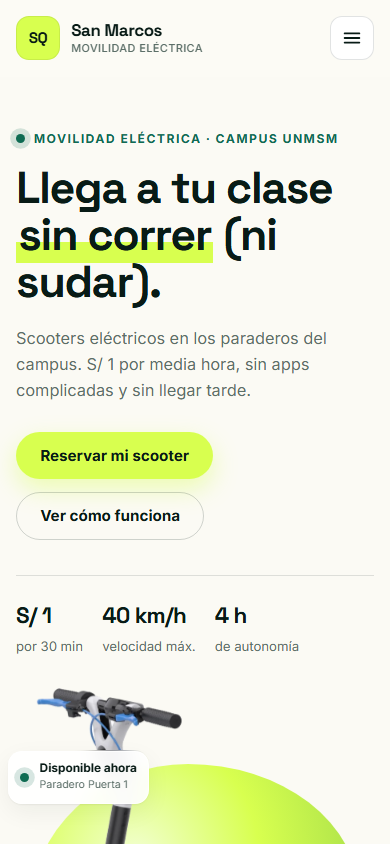

# SQ San Marcos

> Prototipo de movilidad eléctrica para el campus de la UNMSM: scooters, paraderos y una reserva simulada que funciona en menos de un minuto.

[](https://tejedasebastian.github.io/SQ_SAN-MARCOS/)
[](https://github.com/tejedasebastian/SQ_SAN-MARCOS/actions/workflows/e2e.yml)
[](LICENSE)

**Demo:** https://tejedasebastian.github.io/SQ_SAN-MARCOS/

| Escritorio | Móvil |
|---|---|
|  |  |

## Qué es

SQ San Marcos es el rediseño 2026 de un prototipo visual de 2023. La idea original era simple: alquilar scooters eléctricos dentro del campus para moverte entre pabellones sin depender del burrito interno.

Esta versión convierte aquel boceto en una landing completa y responsive, con un flujo de reserva interactivo, validaciones reales y pruebas E2E.

**Es un prototipo académico.** No procesa pagos, no guarda datos y no representa un servicio comercial real.

## Qué incluye

- **Hero editorial** con propuesta de valor, tarifas y prueba visual del producto.
- **Secciones de beneficios, pasos, flota y FAQ** con navegación por anclas.
- **Reserva simulada** con:
  - validación de nombre, paradero, fecha y hora;
  - rechazo de fechas pasadas;
  - cálculo automático del total (30 min, 1 h o 2 h);
  - código de confirmación `SQ-XXXX`;
  - opción de repetir la reserva.
- **Diseño responsive** probado a 320, 390 y 1440 px, sin overflow horizontal.
- **Accesibilidad**: HTML semántico, skip link, labels, `aria-invalid`, `aria-live`, foco visible y `prefers-reduced-motion`.
- **Progressive enhancement**: si JavaScript falla, el contenido sigue siendo visible; solo se pierde la interacción.
- **Sin dependencias de runtime**: HTML, CSS y JS vanilla. Las fuentes están self-hosted.

## Stack

| Capa | Herramienta |
|---|---|
| Markup | HTML5 semántico |
| Estilos | CSS3 con custom properties, grid, flex y `clamp()` |
| Interacción | JavaScript vanilla (IIFE, sin frameworks) |
| Fuentes | Inter + Space Grotesk (WOFF2, self-hosted) |
| Imágenes | WebP con fondo removido |
| Testing | Playwright (Chromium) |
| CI | GitHub Actions |
| Deploy | GitHub Pages (`gh-pages`) |

## Estructura

```text
.
├── index.html
├── css/
│   └── styles.css
├── js/
│   └── main.js
├── fonts/
│   ├── inter-latin.woff2
│   └── space-grotesk-latin.woff2
├── img/
│   ├── favicon.svg
│   ├── hero-scooter.webp
│   ├── scooter-urban.webp
│   └── scooter-night.webp
├── tests/
│   └── e2e.spec.ts
├── scripts/
│   └── preview.mjs
├── playwright.config.ts
├── package.json
└── .github/workflows/e2e.yml
```

## Correr en local

```bash
npm install
npm run serve
```

Abre `http://127.0.0.1:4173`.

También funciona con cualquier servidor estático:

```bash
python -m http.server 4173
```

## Tests E2E

```bash
npm ci
npx playwright install chromium
npm run test:e2e
```

El comando genera un artefacto verificable y repetible:

| Artefacto | Ruta |
|---|---|
| Reporte HTML | `playwright-report/index.html` |
| Resultados JSON | `artifacts/results.json` |
| Traces, videos y screenshots de fallos | `test-results/` |

Para abrir el reporte:

```bash
npm run report
```

Para correr la misma suite contra el sitio publicado:

```bash
npm run test:e2e:live
```

### Escenarios cubiertos

1. **Reserva de 2 horas (escenario principal):** envía el formulario vacío, verifica los cuatro errores, completa los datos, elige 2 horas, comprueba el total `S/ 2.50`, confirma, valida el código `SQ-XXXX`, el resumen y el reinicio del formulario.
2. **Fecha pasada:** intenta reservar con la fecha de ayer, verifica el error y corrige la fecha hasta confirmar.
3. **Móvil:** abre el menú a 390 px, navega a la reserva, comprueba que no haya overflow a 320/390 px, que todas las imágenes carguen y que la consola no tenga errores.
4. **Accesibilidad y enlaces:** skip link, un solo `h1`, anclas internas válidas, `alt` en imágenes, labels en controles y apertura de la FAQ.

El workflow [`.github/workflows/e2e.yml`](.github/workflows/e2e.yml) corre la suite en cada push a `main` y sube `playwright-report/`, `artifacts/` y `test-results/` como artifact.

## Decisiones de diseño

- **Paleta verde + lima eléctrica** para asociar el producto con energía limpia y movimiento, en lugar de los colores dispersos del prototipo original.
- **Tipografía editorial** (Space Grotesk para títulos, Inter para texto) con fuentes self-hosted para eliminar dependencias externas y mejorar la privacidad.
- **Imágenes recortadas con alpha** para integrar los scooters en el fondo sin cajas blancas.
- **Formulario sin backend** para que el prototipo sea desplegable en GitHub Pages y testeable de punta a punta.
- **Reglas de validación explícitas** en JS, no solo atributos HTML, para poder probar los mensajes de error.

## Limitaciones

- Los precios, especificaciones y paraderos son ficticios.
- No hay persistencia: al recargar se pierde la reserva.
- No hay autenticación ni pagos.
- El sitio no reemplaza un sistema real de alquiler.

## Créditos

- Fotos de scooters: assets del prototipo original del proyecto.
- Tipografías: [Inter](https://rsms.me/inter/) y [Space Grotesk](https://fonts.google.com/specimen/Space+Grotesk), bajo SIL Open Font License.
- Diseño y desarrollo: Sebastian Tejeda Alata.

## Licencia

[MIT](LICENSE)
